# 1. 参加者の方へ {#participant}

この章でできることスマホでログインし、エントリー・クイズ回答・結果の確認ができます。

### 1-1. ログインする {#p-login}

受付で渡されたQRコードを、スマホのカメラで読み取ってください。自動でログインされます。QRがない場合は、配られた**ID**と**パスワード**を入力します。

<figure class="shot phone">
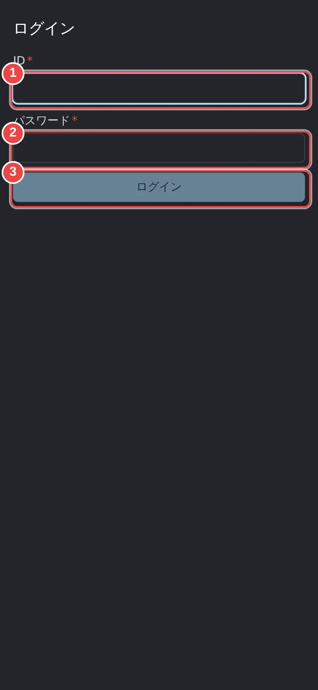
<figcaption>
<strong>ログイン画面(IDとパスワードで入る場合)</strong>
<ol class="marks">
<li>1受付でもらったID</li>
<li>2パスワード</li>
<li>3ログインする</li>
</ol>
</figcaption>
</figure>

<figure class="shot phone">
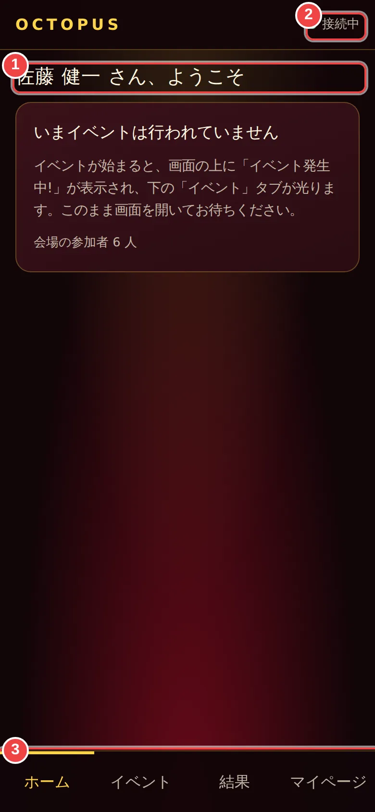
<figcaption>
<strong>ログイン後のホーム</strong>
<ol class="marks">
<li>1あなたの名前</li>
<li>2会場とつながっていれば「接続中」</li>
<li>3下のタブで画面を切り替える</li>
</ol>
</figcaption>
</figure>

<b>ポイント</b>上の「接続中」が出ていれば、会場とつながっています。イベントが始まるまで、この画面を開いたままお待ちください。

### 1-2. エントリーする {#p-entry}

司会者がエントリー受付を始めると、画面に大きな丸いボタンが出ます。タップすると「エントリー済み」になり、会場のスクリーンにあなたの顔写真が表示されます。

<figure class="shot phone">
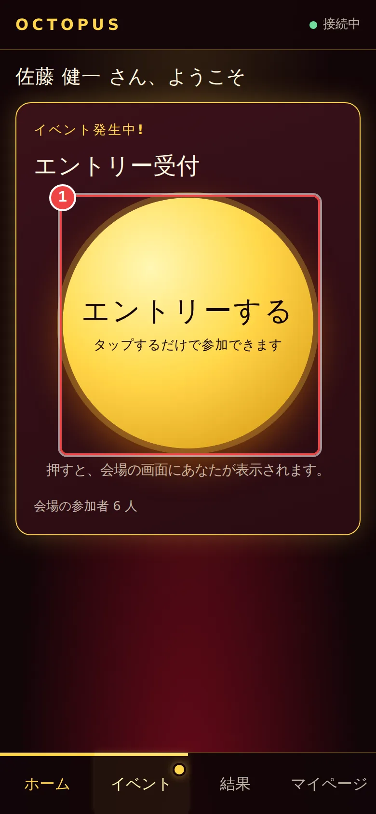
<figcaption>
<strong>受付中</strong>
<ol class="marks">
<li>1タップしてエントリーする</li>
</ol>
</figcaption>
</figure>
<figure class="shot phone">
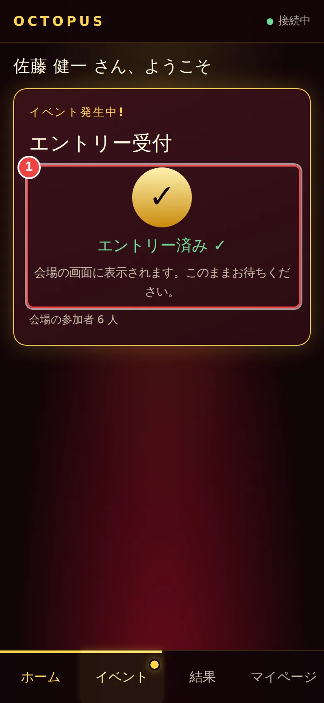
<figcaption>
<strong>エントリー済み</strong>
<ol class="marks">
<li>1「エントリー済み」になれば完了</li>
</ol>
</figcaption>
</figure>

### 1-3. クイズに答える {#p-quiz}

問題と選択肢が出ます。**残り秒数**が0になる前に、答えをタップしてください。受付中は選び直せますが、最後に選んだものが回答になります。

<figure class="shot phone">
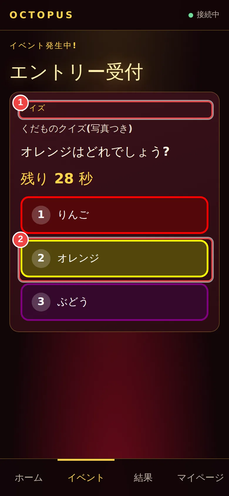
<figcaption>
<strong>出題中</strong>
<ol class="marks">
<li>1問題と選択肢が出る(残り秒数つき)</li>
<li>2答えをタップ</li>
</ol>
</figcaption>
</figure>
<figure class="shot phone">
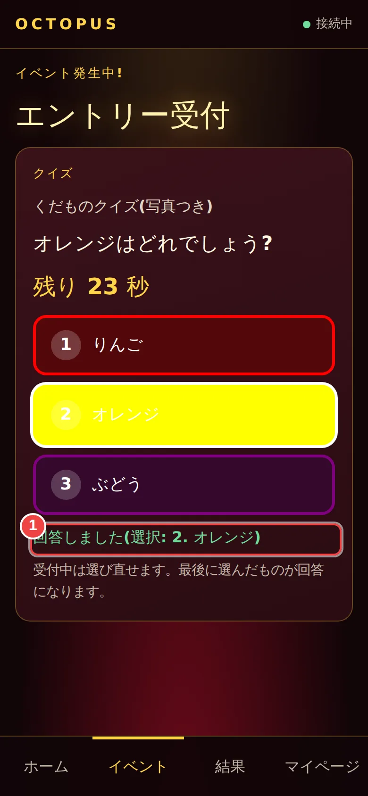
<figcaption>
<strong>回答した後</strong>
<ol class="marks">
<li>1回答済み(変更はできない)</li>
</ol>
</figcaption>
</figure>

<figure class="shot phone">
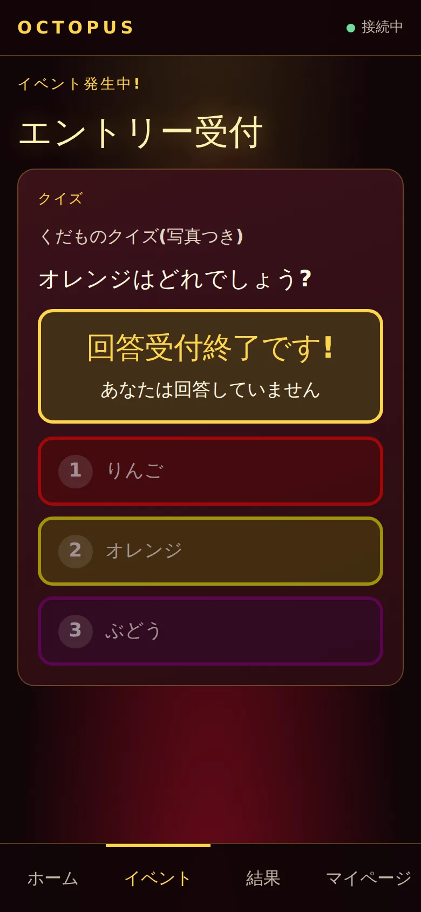
<figcaption>
<strong>受付終了</strong>
</figcaption>
</figure>
<figure class="shot phone">
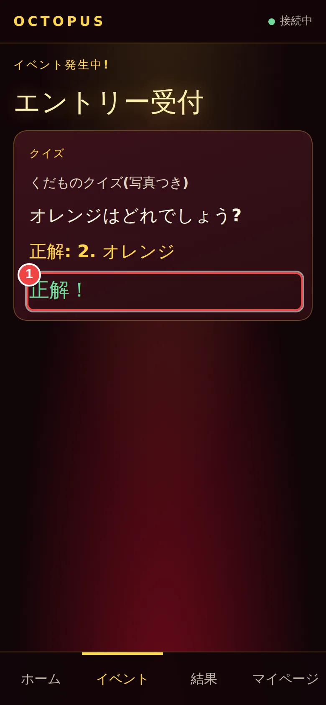
<figcaption>
<strong>正解発表</strong>
<ol class="marks">
<li>1正解・不正解がわかる</li>
</ol>
</figcaption>
</figure>

順位の発表中は「会場の画面をご覧ください」と出ます。会場のスクリーンで確認しましょう。

### 1-4. ジャックポット抽選 {#p-jackpot}

エントリーした人の中から抽選されます。当選すると、スマホに紙吹雪つきの「あたりました!」が出ます。会場の前に出てきてください。

<figure class="shot phone">
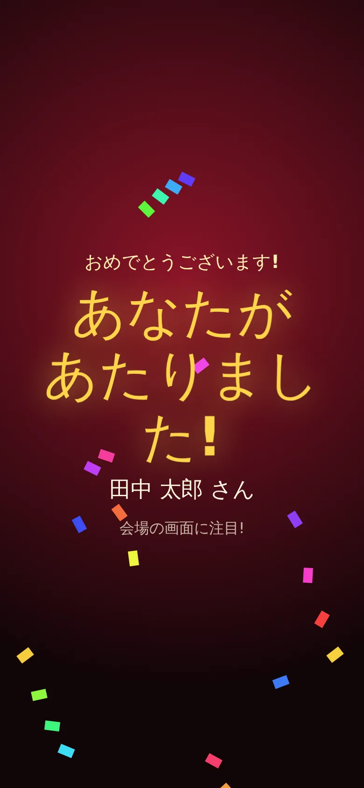
<figcaption>
<strong>当選したときの画面</strong>
</figcaption>
</figure>

### 1-5. 結果を見る・ログアウトする {#p-results}

下の「結果」タブで、クイズの順位と、ジャックポットの当選履歴を見られます。自分の当選は目立つ表示になります。

<figure class="shot phone">
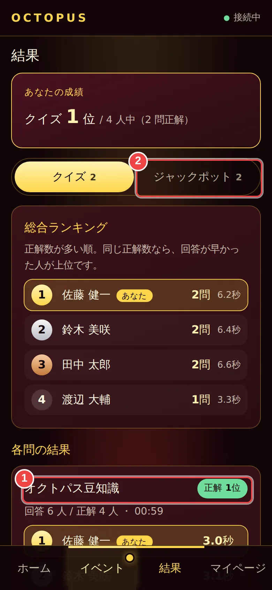
<figcaption>
<strong>結果(クイズ)</strong>
<ol class="marks">
<li>1出題ごとの順位・正解</li>
<li>2ジャックポットの結果に切り替え</li>
</ol>
</figcaption>
</figure>
<figure class="shot phone">
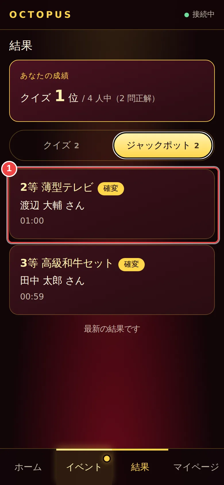
<figcaption>
<strong>結果(ジャックポット)</strong>
<ol class="marks">
<li>1当選の履歴(自分が当たると強調される)</li>
</ol>
</figcaption>
</figure>

<figure class="shot phone">
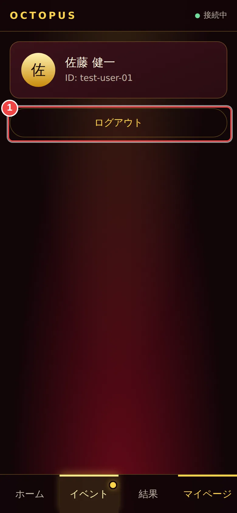
<figcaption>
<strong>マイページ</strong>
<ol class="marks">
<li>1使い終わったらログアウト</li>
</ol>
</figcaption>
</figure>

### 1-6. 困ったとき {#p-trouble}

- 「接続中」にならない → 画面を引き下げて再読み込みしてください。
- ログインできない → IDとパスワードを確認し、それでも入れなければ受付に声をかけてください。QRの再発行ができます。
- エントリーボタンが出ない → 受付が始まっていないか、すでに締め切られています。

<nav class="pager" aria-label="前後の章">
<a class="prev" href="index.md"><small>前の章</small>‹ はじめに</a><a class="next" href="02-prep-people.md"><small>次の章</small>2. 事前準備:人と景品 ›</a>
</nav>
