# 2. 事前準備:人と景品 {#prep}

この章でできることメンバー(共通の名簿)と受付QR、景品を準備できます。

準備は、管理者のホーム画面から行います。管理者アカウントでログインすると表示されます。

<figure class="shot">
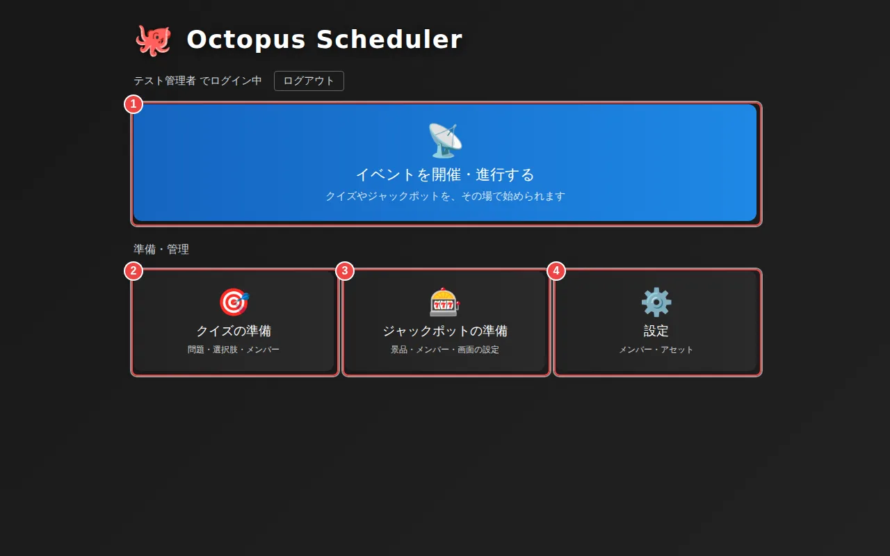
<figcaption>
<strong>管理者のホーム</strong>
<ol class="marks">
<li>1イベントを開催・進行する(当日はここから)</li>
<li>2クイズの問題や選択肢をつくる</li>
<li>3景品・メンバー・画面を整える</li>
<li>4メンバー・素材</li>
</ol>
</figcaption>
</figure>

### 2-1. メンバー(共通の名簿)を登録して受付QRを印刷する {#prep-members}

「設定」→「メンバー」タブが、**共通の名簿**です。ここに登録した人は、ジャックポットやクイズなど、すべてのゲームの管理画面から使えます。顔写真も名簿に保存されるので、会場PCがどのパソコンでも、同じ写真が表示されます。

名簿の人には、名前と写真のほかに、ログインに使う**パスワード**、**管理者の権限**、**受付QR**も付けられます。1つの表で、人ごとに全部を確かめて直せます。

<figure class="shot">
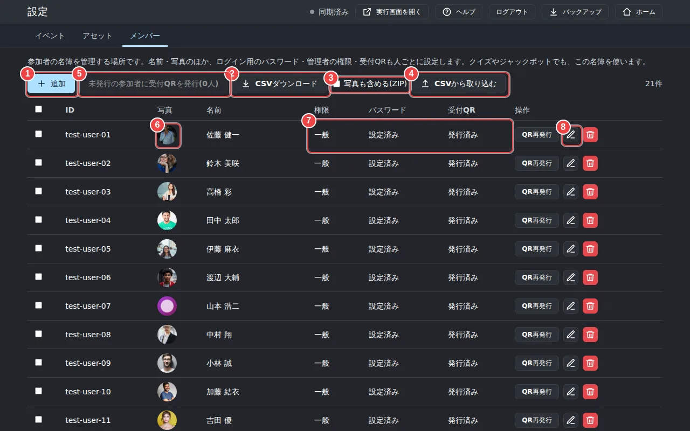
<figcaption>
<strong>設定のメンバータブ(共通の名簿)</strong>
<ol class="marks">
<li>1名簿に1人ずつ追加する</li>
<li>2名簿をCSVで書き出す</li>
<li>3書き出すときに写真も入れる(ZIPになる)</li>
<li>4CSVやZIPからまとめて取り込む</li>
<li>5受付QRをまだ発行していない参加者に、まとめて発行する</li>
<li>6顔写真(写真がない人は、頭文字のアイコン)</li>
<li>7権限・パスワード・受付QRの状態</li>
<li>8QRの発行・再発行、編集、削除</li>
</ol>
</figcaption>
</figure>

**1人ずつ登録する場合:**「追加」を押し、ID(英数字)と名前を入れます。「写真(任意)」で写真を選ぶと、長辺512pxに縮小して保存されます。写真をやめたいときは、編集ダイアログの「写真を外す」を押します。

下の「ログイン」欄では、管理者にするかどうかと、パスワードを決めます。パスワードは8文字以上で、管理者には必須です。参加者は、パスワードを決めなくても、受付QRだけで入れます。編集のときにパスワードを空欄にすると、いまのパスワードのままです。

<figure class="shot">
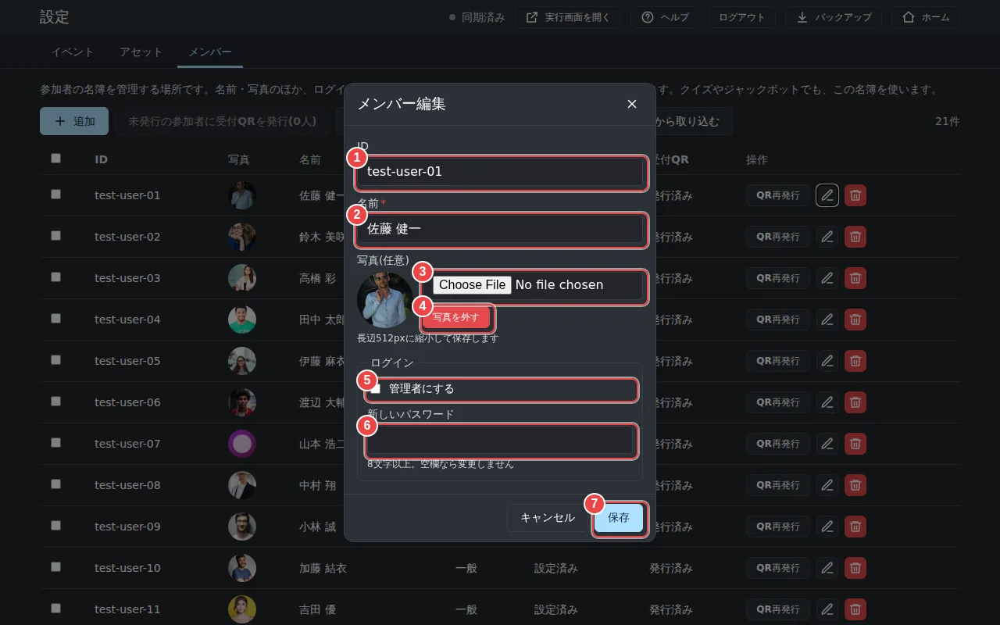
<figcaption>
<strong>メンバー編集ダイアログ</strong>
<ol class="marks">
<li>1ID(追加のときだけ入力できる)</li>
<li>2名前</li>
<li>3写真を選ぶ</li>
<li>4写真を外す</li>
<li>5管理者にする</li>
<li>6パスワード(空欄ならそのまま)</li>
<li>7保存する</li>
</ol>
</figcaption>
</figure>

<b>ポイント</b>いまログインしている自分は、管理者の権限を外したり、削除したりできません。また、パスワードを設定した管理者が1人もいない状態でログアウトすると、管理画面に入れなくなるので、一覧の上に警告が出ます。

**まとめて登録する場合:**「CSVダウンロード」で、いまの名簿をCSVで書き出せます。1行目は見出しで、`ID,名前,写真,管理者`の形です(管理者は「あり」か「なし」。空のままなら変わりません)。「写真も含める(ZIP)」にチェックを入れると、写真の画像も入ったZIPになります。これを編集して「CSVから取り込む」で戻せば、まとめて追加・更新できます(書き出したものをそのまま戻すと、全行が「変更なし」になります)。パスワードと受付QRはCSVに含まれないので、取り込み後に必要な人だけ設定します。「管理者」を「あり」にした人は受付QRが使えなくなり(管理者はパスワードでログインします)、「なし」にした人はログイン中でも操作できなくなります。ログイン中の自分を「なし」にする行や、管理者を0人にする取り込みは、エラーになって取り込めません。

<ol class="steps">
<li>「CSVから取り込む」を押す。</li>
<li>「CSV または ZIP」で、CSVか、写真つきで書き出したZIPを選ぶ。</li>
<li>CSVの「写真」列にファイル名を書いたときは、「画像フォルダ(任意)」でその画像が入ったフォルダを選ぶ(ZIPなら不要)。</li>
<li>CSVに無い人を削除したいときだけ、「ファイルに無い行を削除する(置き換え)」にチェックを入れる(管理者と自分は削除されません)。</li>
<li>プレビューで、行ごとに「追加」「更新」「変更なし」「削除」「エラー」を確かめる。エラーの行が1つでもあると取り込めないので、ファイルを直して選び直します。</li>
<li>「取り込む」を押す。終わると、取り込んだ結果が表示されます。</li>
</ol>

<figure class="shot">
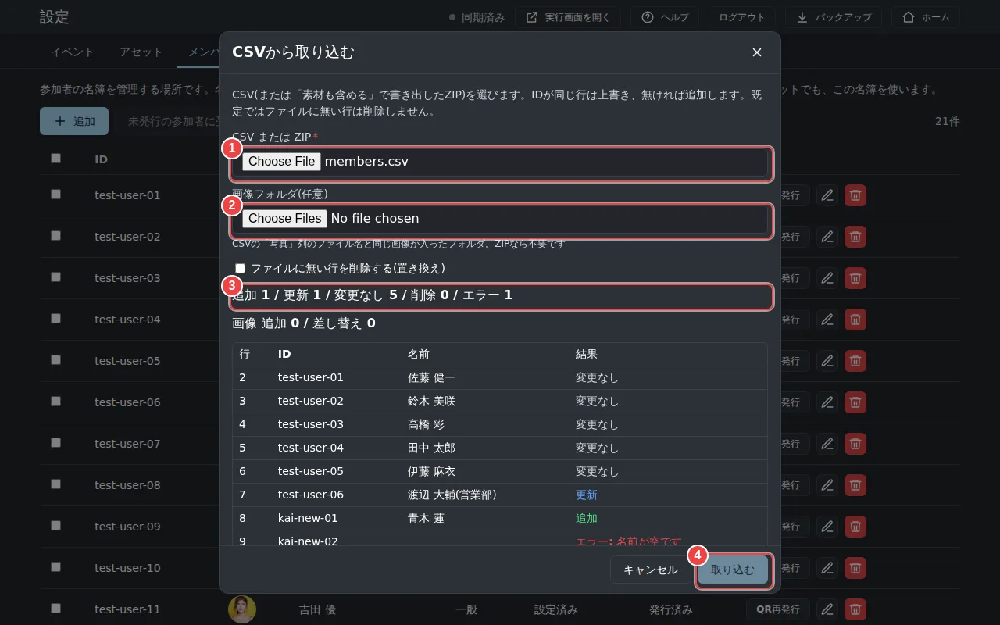
<figcaption>
<strong>「CSVから取り込む」ダイアログ(プレビュー)</strong>
<ol class="marks">
<li>1CSVまたはZIPを選ぶ</li>
<li>2画像フォルダを選ぶ(任意)</li>
<li>3追加・更新・変更なし・エラーの件数と、行ごとの結果</li>
<li>4確認できたら取り込む</li>
</ol>
</figcaption>
</figure>

<b>ポイント</b>IDが同じ人は上書きされ、IDがなければ新しく追加されます。CSVに載っていない人は、削除されません。

<strong>受付QRを発行して印刷する:</strong>登録しただけの人(QR未発行)がいると、「未発行の参加者に受付QRを発行」が押せるようになります。管理者には受付QRを発行できません。

<figure class="shot">
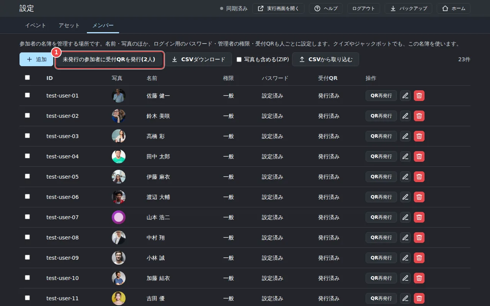
<figcaption>
<strong>未発行の参加者がいるとき</strong>
<ol class="marks">
<li>1未発行の人にまとめてQRを発行する</li>
</ol>
</figcaption>
</figure>

<figure class="shot">
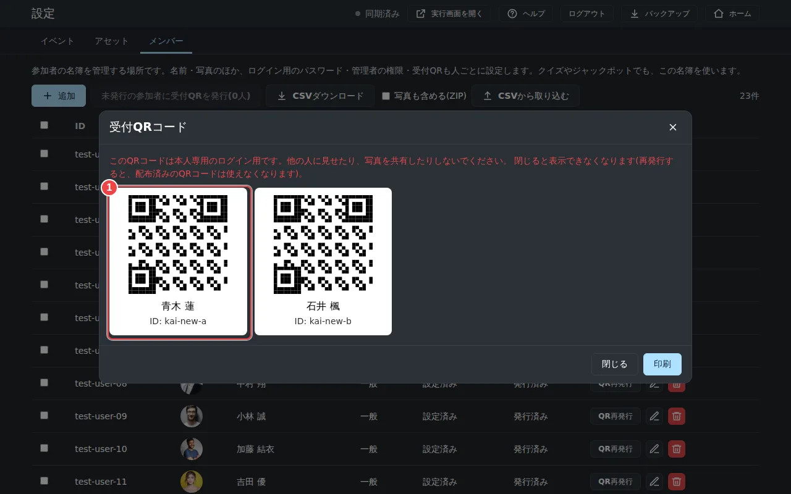
<figcaption>
<strong>受付QRコードシート</strong>
<ol class="marks">
<li>1印刷して参加者に配る(QRはここでしか表示されない)</li>
</ol>
</figcaption>
</figure>

<b>注意</b>QRコードは、この画面を閉じると二度と表示できません。必ず印刷してから閉じてください。なくした場合は「QR再発行」を使います(以前のQRは使えなくなります)。QRは本人専用です。写真を共有しないよう参加者に伝えてください。

**ジャックポットのメンバーにする:**「ジャックポットの準備」→「メンバー」タブを開き、「追加」で「共有マスタから選択」を選ぶと、名簿にいる人を選べます。ここでは、**メンバー抽選の当選しやすさ**(1〜10、標準5。大きいほど選ばれやすい)を決めます。

<figure class="shot">
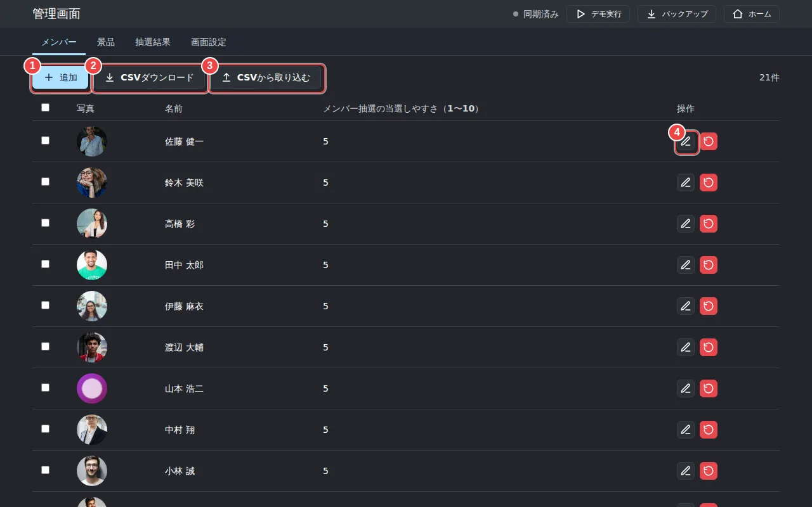
<figcaption>
<strong>ジャックポット管理 メンバー</strong>
<ol class="marks">
<li>1名簿から選んで、メンバーを追加する</li>
<li>2当選しやすさを入れるCSVのひな形をダウンロード</li>
<li>3当選しやすさをCSVでまとめて設定する</li>
<li>4当選しやすさを編集する</li>
</ol>
</figcaption>
</figure>

<figure class="shot">
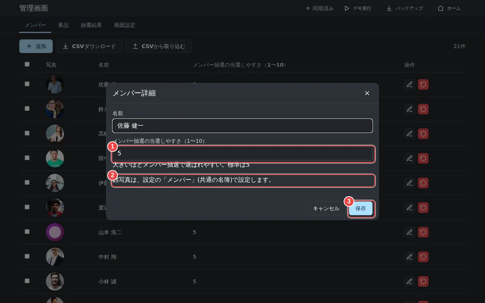
<figcaption>
<strong>メンバー詳細ダイアログ</strong>
<ol class="marks">
<li>1メンバー抽選の当選しやすさ(1〜10、標準5)</li>
<li>2顔写真は、ここではなく設定の「メンバー」で設定する</li>
<li>3保存する</li>
</ol>
</figcaption>
</figure>

**当選しやすさをまとめて設定する場合:**「書式CSV」を押すと、いまのメンバーが入った状態のCSVが書き出されます。1行目は見出しで、`ID,名前,当選しやすさ`の形です。当選しやすさ(1〜10)を書き換えて、「データ取込」から読み込みます。

<figure class="shot">
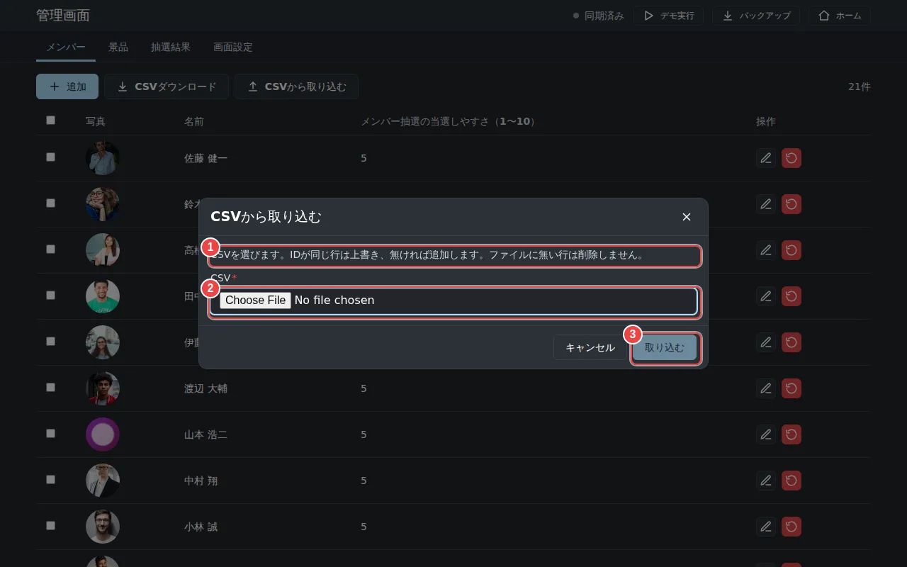
<figcaption>
<strong>メンバーのデータ取込ダイアログ</strong>
<ol class="marks">
<li>1設定できる列(ID,名前,当選しやすさ)の説明</li>
<li>2CSVファイルを選ぶ</li>
<li>3取り込みを始める</li>
</ol>
</figcaption>
</figure>

<b>ポイント</b>データ取込は、IDごとに当選しやすさを設定するだけです(古いCSVの「ランク」列は無視されます)。名簿にいないIDの行は、読み飛ばされます。「当選しやすさ」は1〜10で、全員が同じ値なら、全員が同じ確率で当選します。

### 2-2. 景品を登録する {#prep-prizes}

「景品」タブで、景品の名前・景品ランク(1〜5、標準3。5=豪華でレア=当たりにくい)・画像・抽選アニメーションを設定します。「データ取込」でまとめて登録することもできます(CSVの列は、ID・名前・景品ランク・アニメーション・確変対応・抽選画像・当選画像・当選BGM・確変_抽選画像・確変_当選画像・確変_当選BGM。確変対応は「あり」か「なし」)。

<figure class="shot">
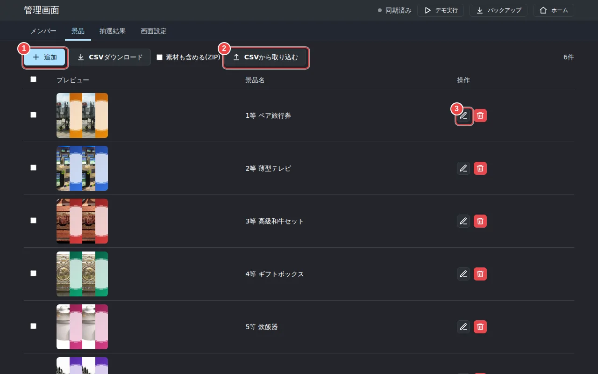
<figcaption>
<strong>ジャックポット管理 景品</strong>
<ol class="marks">
<li>1景品を追加する</li>
<li>2CSVと画像をまとめて取り込む</li>
<li>3景品の内容を編集する</li>
</ol>
</figcaption>
</figure>

<figure class="shot">
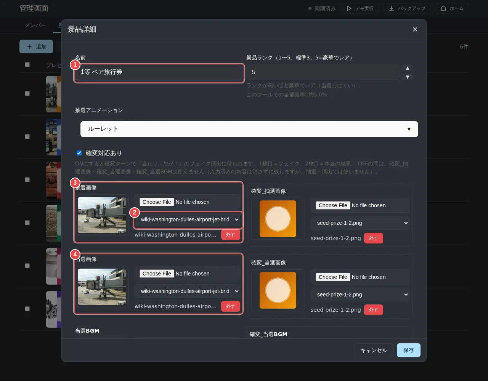
<figcaption>
<strong>景品の編集フォーム</strong>
<ol class="marks">
<li>1景品の名前</li>
<li>2抽選アニメーション(ルーレット/スロット)</li>
<li>3景品画像(ルーレットなどに出る)</li>
<li>4当選したときに大きく出る画像</li>
</ol>
</figcaption>
</figure>

<b>ポイント</b>「抽選画像」は抽選中に出る絵、「当選画像」は当選したときに大きく出る絵です。「当選BGM」も景品ごとに選べます。「確変_抽選画像」「確変_当選画像」「確変_当選BGM」は、「確変対応あり」にチェックを入れた景品だけで使えます(チェックなしの間は選べません)。確変対応ありの景品は、確変の回に『当たり…だが！』のフェイク演出(1枚目＝フェイク、2枚目＝本当の結果)で当たります。確変になる回数は、確変対応ありの景品の数と同じです。

<figure class="shot">
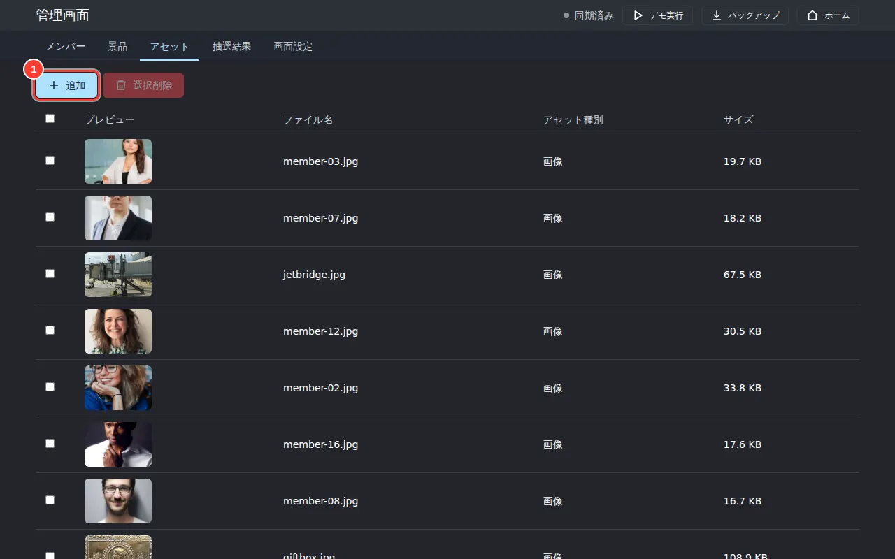
<figcaption>
<strong>ジャックポット管理 アセット</strong>
<ol class="marks">
<li>1画像・音声を追加する</li>
</ol>
</figcaption>
</figure>

<nav class="pager" aria-label="前後の章">
<a class="prev" href="01-participant.md"><small>前の章</small>‹ 1. 参加者の方へ</a><a class="next" href="03-prep-quiz.md"><small>次の章</small>3. 事前準備:クイズと画面 ›</a>
</nav>
