# 3. 事前準備:クイズと画面 {#prep2}

この章でできることクイズ、抽選会の画面を準備し、同期の状態を確認できます。

人と景品の準備(メンバー・景品)は、2章で説明しています。

### 3-1. クイズを作る {#prep-quiz}

ホームの「クイズの準備」を開きます。「新規クイズ追加」で、問題・回答時間・選択肢・正解を入力します。

<figure class="shot">
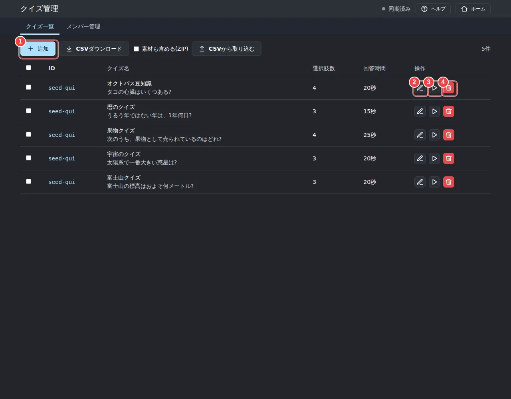
<figcaption>
<strong>クイズ一覧</strong>
<ol class="marks">
<li>1クイズを1問追加する</li>
<li>2編集する</li>
<li>3この問題だけ画面で確認(プレビュー)</li>
<li>4削除する</li>
</ol>
</figcaption>
</figure>

<figure class="shot">
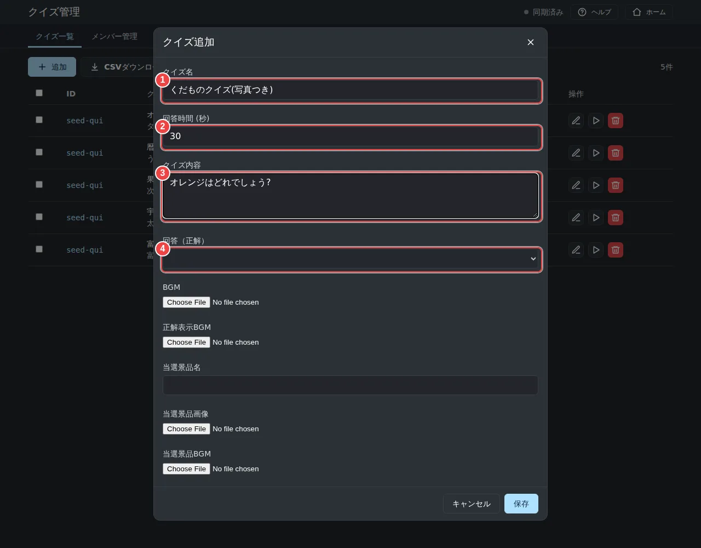
<figcaption>
<strong>クイズの追加・編集ダイアログ(上半分)</strong>
<ol class="marks">
<li>1クイズの名前</li>
<li>2回答できる秒数</li>
<li>3出題する文章</li>
<li>4正解の選択肢</li>
</ol>
</figcaption>
</figure>

選択肢は「選択肢を追加」で1つずつ入れます。文字だけでも、写真つきでも作れます。

<figure class="shot">
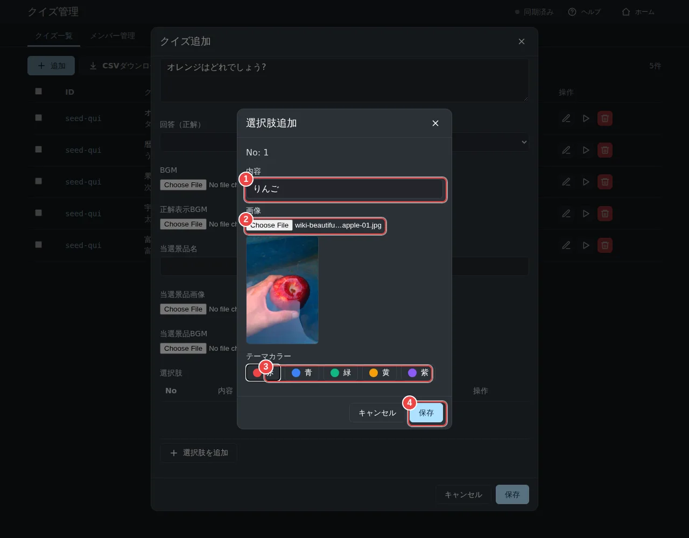
<figcaption>
<strong>選択肢の追加ダイアログ</strong>
<ol class="marks">
<li>1選択肢の文字</li>
<li>2写真をつけたいときに選ぶ(なくてもよい)</li>
<li>3ボタンの色</li>
<li>4保存して一覧に戻る</li>
</ol>
</figcaption>
</figure>

<figure class="shot">
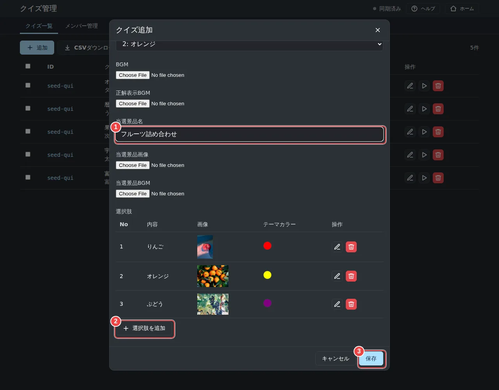
<figcaption>
<strong>クイズの追加・編集ダイアログ(下半分)</strong>
<ol class="marks">
<li>1正解した人に贈る景品名(任意)</li>
<li>2選択肢を追加する(2〜8個)</li>
<li>3保存する</li>
</ol>
</figcaption>
</figure>

<figure class="shot">
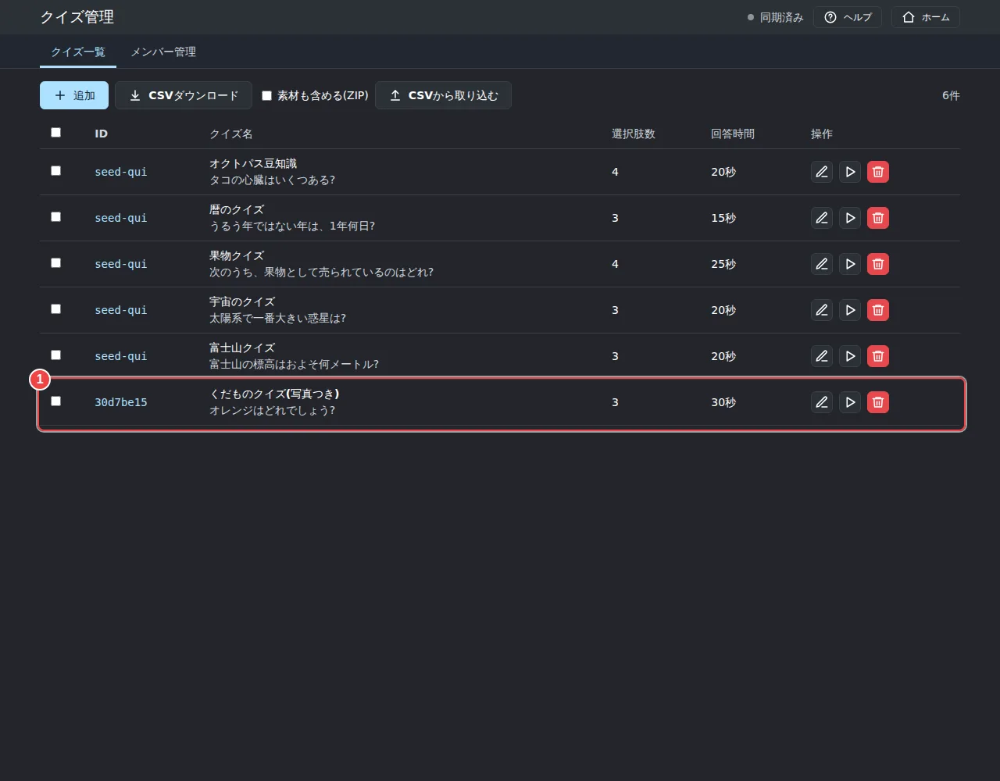
<figcaption>
<strong>クイズ追加後の一覧</strong>
<ol class="marks">
<li>1追加したクイズが一覧に出る</li>
</ol>
</figcaption>
</figure>

<b>ポイント</b>保存する前に、「回答（正解）」の欄が正しい選択肢になっているか、あらためて確認しておくと安心です。

<figure class="shot">
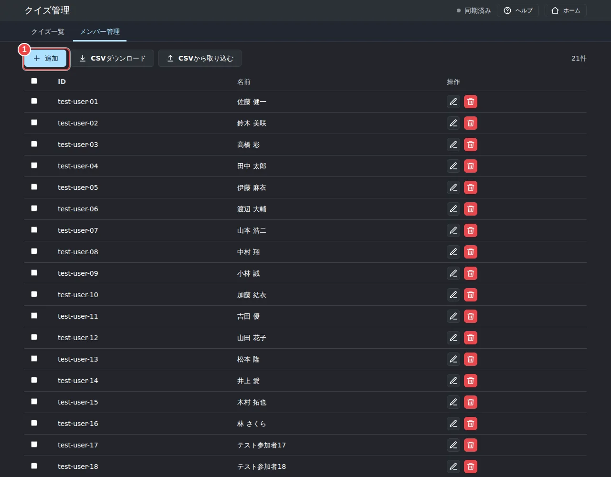
<figcaption>
<strong>クイズ メンバー管理</strong>
<ol class="marks">
<li>1クイズの参加者名簿を追加する</li>
</ol>
</figcaption>
</figure>

<b>ポイント</b>クイズ一覧の上のボタンから、クイズをCSV(または選択肢の画像・BGMを含めたZIP)でまとめて書き出し・取り込みできます。取り込みは、ファイルに無いクイズを削除する「置き換え」です。列は ID・タイトル・問題・制限時間(秒)・正解(選択肢の番号)・BGM・正解BGM・景品名・景品画像・景品BGM・選択肢N・選択肢N画像・選択肢N色(Nは番号)。見出しが古い、素材が見つからない、などの行があるとエラーになり、取り込めません。

<figure class="shot">
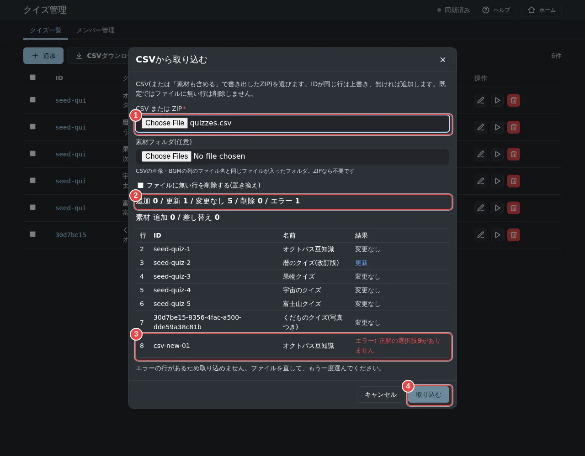
<figcaption>
<strong>クイズ一覧のCSV取込(プレビュー)</strong>
<ol class="marks">
<li>1CSVまたはZIPを選ぶ</li>
<li>2追加・更新・変更なし・削除・エラーの件数</li>
<li>3エラーの行(理由が出る。1つでもあると取り込めない)</li>
<li>4確認できたら取り込む</li>
</ol>
</figcaption>
</figure>

### 3-2. 抽選会の画面を整える {#prep-screens}

「ジャックポットの準備」→「画面設定」では、会場スクリーンに出る文章・画像・BGMを設定します。変更したら必ず「保存」を押します。「デモ抽選」では、デモBGMとデモ抽選SE(抽選のときの効果音)を選びます。「本抽選」では、メンバー抽選のBGM(複数追加できます)、景品抽選が止まるまでの秒数、確変の起こし方と確変にする回を設定します。

<b>ポイント</b>ほかの端末で保存した変更は、この画面の入力欄にも自動で反映されます。ただし、いま編集している欄は書き換わりません。

<figure class="shot">
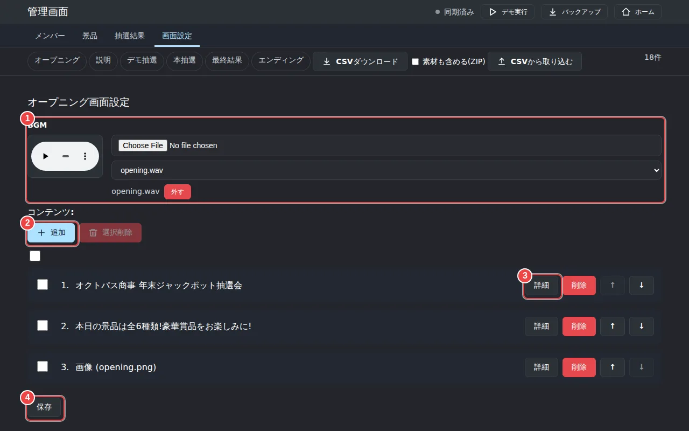
<figcaption>
<strong>画面設定 オープニング</strong>
<ol class="marks">
<li>1BGM(曲)を選ぶ</li>
<li>2表示する文章・画像を追加する</li>
<li>31つずつ内容を編集する</li>
<li>4変更したら保存を押す</li>
</ol>
</figcaption>
</figure>

<figure class="shot">
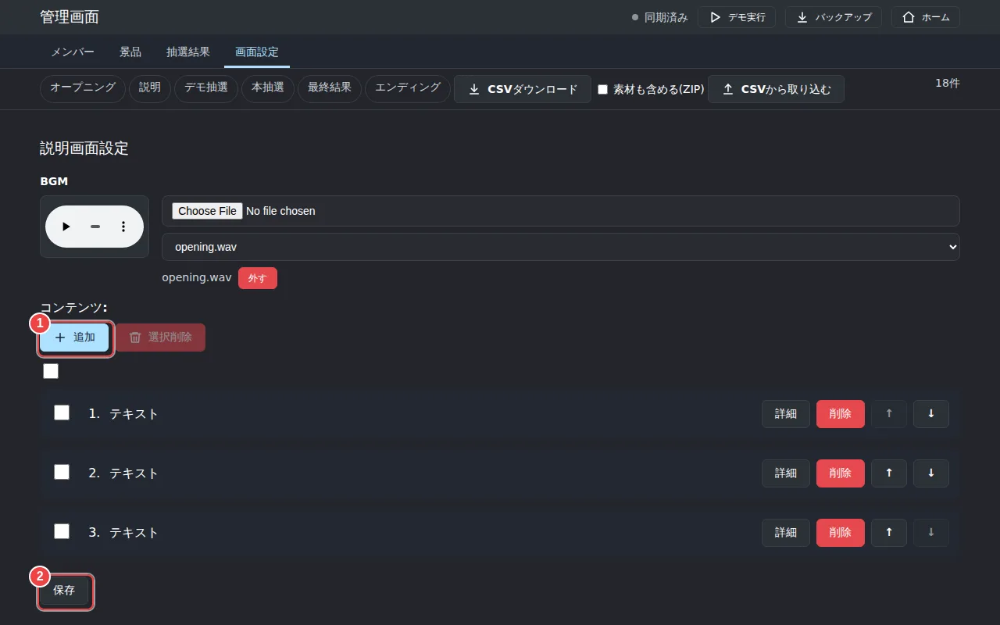
<figcaption>
<strong>画面設定 説明</strong>
<ol class="marks">
<li>1説明の文章・画像を追加する</li>
<li>2保存する</li>
</ol>
</figcaption>
</figure>

<figure class="shot">
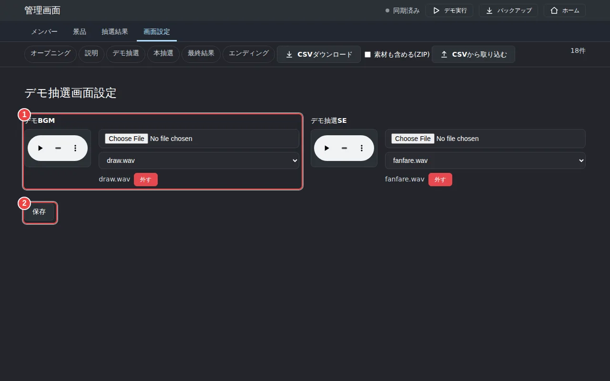
<figcaption>
<strong>画面設定 デモ抽選</strong>
<ol class="marks">
<li>1デモ中に流す曲</li>
<li>2保存する</li>
</ol>
</figcaption>
</figure>

<figure class="shot">
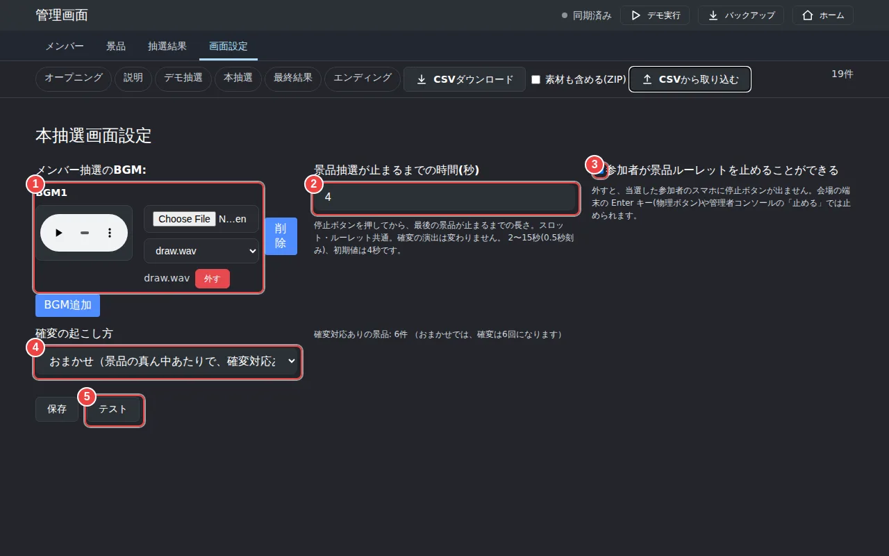
<figcaption>
<strong>画面設定 本抽選</strong>
<ol class="marks">
<li>1抽選中に流す曲</li>
<li>2止まるまでの秒数</li>
<li>3確変(連続当選)の設定</li>
<li>4設定のままテストする</li>
</ol>
</figcaption>
</figure>

<figure class="shot">
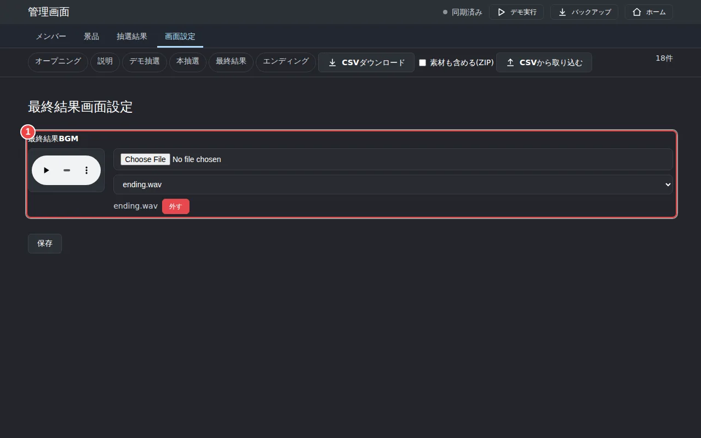
<figcaption>
<strong>画面設定 最終結果</strong>
<ol class="marks">
<li>1最終結果の曲</li>
</ol>
</figcaption>
</figure>

<figure class="shot">
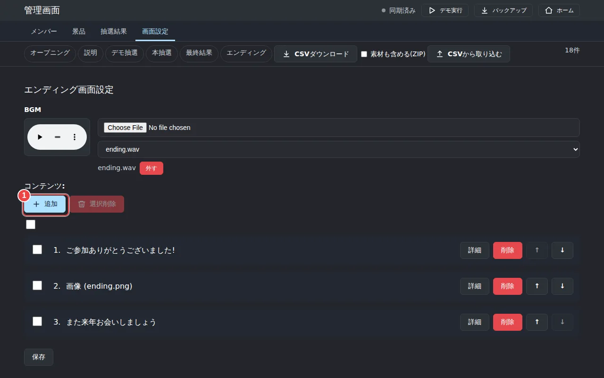
<figcaption>
<strong>画面設定 エンディング</strong>
<ol class="marks">
<li>1エンディングの文章・画像</li>
</ol>
</figcaption>
</figure>

<figure class="shot">
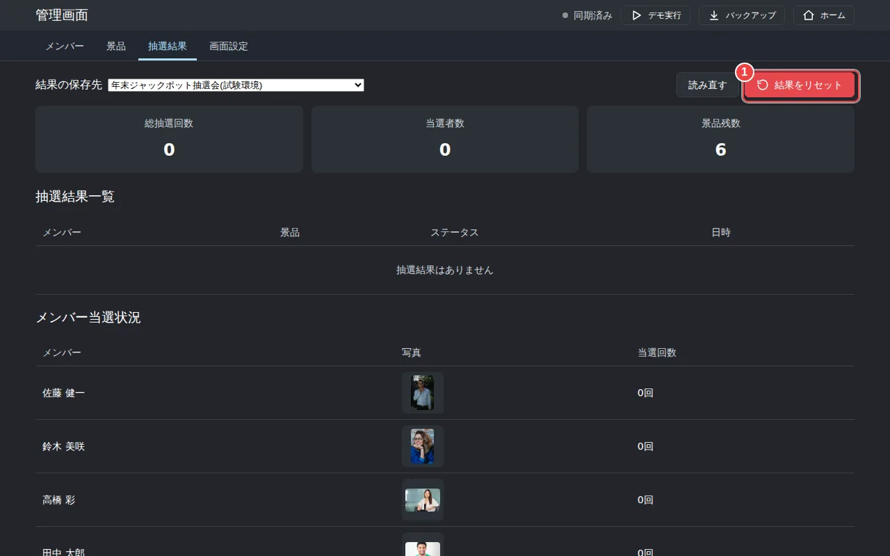
<figcaption>
<strong>「抽選結果」タブ(本番前のリセットに使う)</strong>
<ol class="marks">
<li>1本番前に結果を空に戻す</li>
</ol>
</figcaption>
</figure>

**画面設定をまとめて書き出し・取り込みする場合:**「画面設定」の上のボタンで、6つの画面の設定を1つのCSVにまとめて書き出せます。「素材も含める(ZIP)」を選ぶと、使っている画像・音もZIPに入ります。取り込むときは、CSVと一緒に素材のフォルダを選ぶか、ZIPを選びます(ZIPの中は media/ フォルダに素材を入れます)。

<ul>
<li>列は 画面・項目・素材・文字・種類・効果・秒数・効果音・コンテンツ名 です。「画面」は オープニング・説明・デモ抽選・本抽選・最終結果・エンディング のどれかです。</li>
<li>「項目」は画面ごとに決まっていて、BGM・抽選SE・メンバー抽選BGM・確変の回・停止秒数・コンテンツ があります。</li>
<li>同じ画面・項目の重複行、見つからない素材、音と画像の取り違えはエラーになり、エラーの行が1つでもあると取り込めません。</li>
<li>取り込むと、開いている画面設定が読み直されます。</li>
</ul>

<figure class="shot">
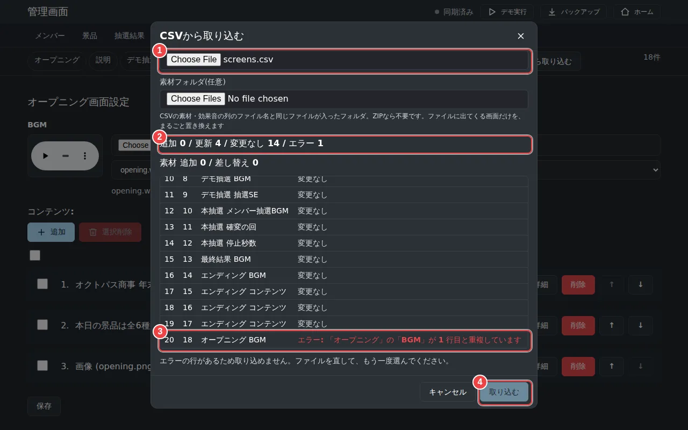
<figcaption>
<strong>画面設定のCSV取込(プレビュー)</strong>
<ol class="marks">
<li>1CSVまたはZIPを選ぶ</li>
<li>2追加・更新・変更なし・エラーの件数</li>
<li>3エラーの行(同じ画面・項目の重複など。理由が出る)</li>
<li>4確認できたら取り込む</li>
</ol>
</figcaption>
</figure>

### 3-3. 設定の他のタブ {#prep-other}

ふだんは触らなくて構いません。画像・動画・音声の素材(アセット)と、予定イベントの実行を管理する場所です。予定イベントは「音楽」「スクリーン」「画面遷移」の3種類です。アセットとイベントは、どちらも上のボタンからCSV/ZIPでまとめて書き出し・取り込みできます。アセットの列は「名前」と「フォルダ」(フォルダは1階層だけ)、取り込むときは、名前と同じファイルが入った素材フォルダか、ZIPを選びます。イベントの列は ID・種別・開始・終了・素材・表示・フォルダ・切替秒・切替効果・フェードアウト秒・遷移先URL で、取り込みはファイルに無いイベントを削除する置き換えです。当日に音楽やスクリーンを手元で出す方法は 4-7 を参照してください。名簿(メンバー)は 2-1 で説明しています。

<figure class="shot">
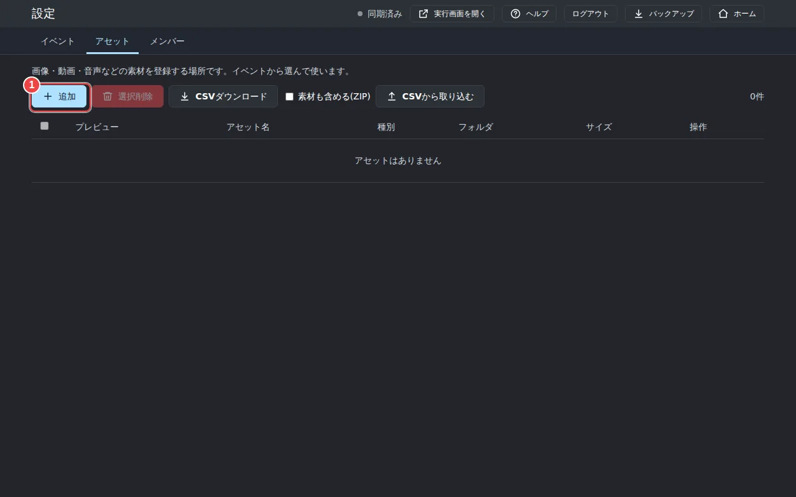
<figcaption>
<strong>設定のアセットタブ</strong>
<ol class="marks">
<li>1画像・音声を登録する</li>
</ol>
</figcaption>
</figure>

<figure class="shot">
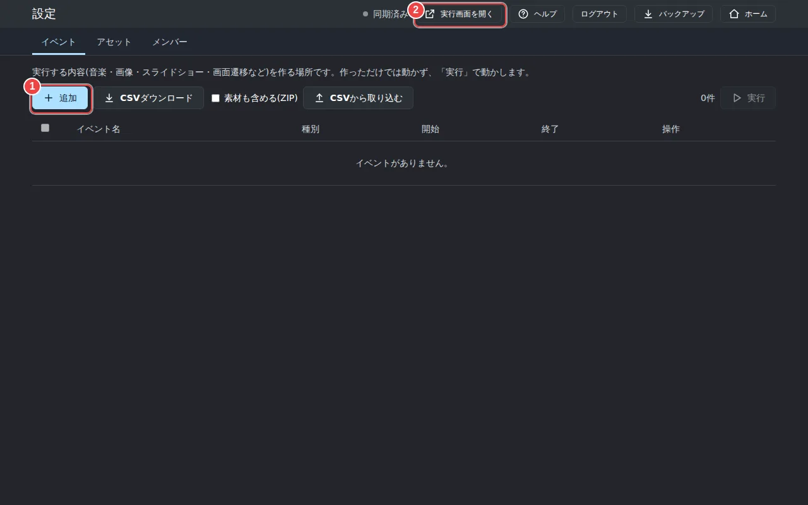
<figcaption>
<strong>設定のイベントタブ</strong>
<ol class="marks">
<li>1イベントを追加する</li>
<li>2選んだイベントを実行する</li>
</ol>
</figcaption>
</figure>

### 3-4. 同期の状態と詳細を確認する {#prep-sync}

設定した内容は、この端末に保存されると同時に、自動でサーバーへ送られます。別の端末で変えた内容も、自動で取り込まれます。画面の右上(ヘッダー)の表示で、いまの状態を確かめられます。

- **同期済み** … 送るものも取り込むものも残っていません。
- **同期中...** … 送信または取り込みをしています。
- **同期エラー(押すと詳細)** … 通信などの失敗で、送れなかったものがあります。次の同期で、自動でもう一度送ります。

この表示は押せます。押すと「同期の状態」が開き、**失敗した対象と理由**、そして**他の端末の変更を反映した記録**(直近50件。この画面を開いている間だけ残ります)を、時刻つきで確かめられます。ふだんは見なくて構いません。「値が知らないうちに変わった」「保存したはずなのに反映されない」ときに開いてください。

<figure class="shot">
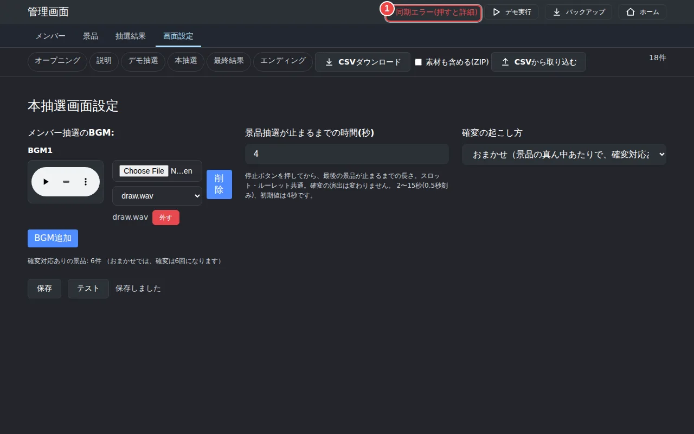
<figcaption>
<strong>ヘッダーの同期エラーの表示</strong>
<ol class="marks">
<li>1押すと、同期の詳細が開く</li>
</ol>
</figcaption>
</figure>

<figure class="shot">
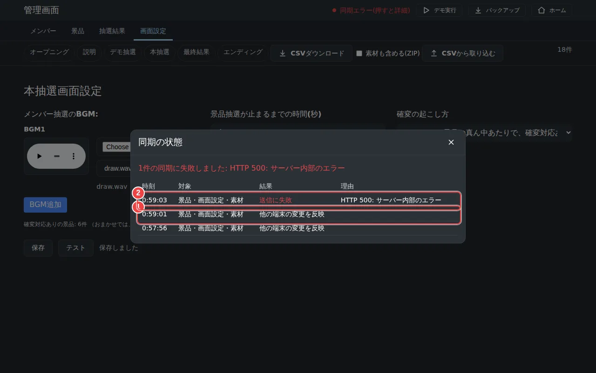
<figcaption>
<strong>同期の状態(詳細)</strong>
<ol class="marks">
<li>1他の端末の変更を反映した記録</li>
<li>2送信に失敗した記録(対象と理由)</li>
</ol>
</figcaption>
</figure>

<b>ポイント</b>送信の途中で別の値を保存しても、あとの値が残り、次の同期で送られます。

<b>注意</b>ゲームの設定(画面設定・景品・名簿・クイズなど)は、一覧全体を1つの単位として「新しく保存したほうが残る」しくみです。2台でほぼ同時に別の項目を編集すると、あとから保存したほうの一覧が残り、先に保存した端末の変更は取り込まれません。先に保存した端末の詳細には「他の端末の変更を反映」と記録されるので、何が起きたかを確かめられます。同じ設定は、できるだけ1台で編集してください。

<nav class="pager" aria-label="前後の章">
<a class="prev" href="02-prep-people.md"><small>前の章</small>‹ 2. 事前準備:人と景品</a><a class="next" href="04-day.md"><small>次の章</small>4. 当日の進行 ›</a>
</nav>
