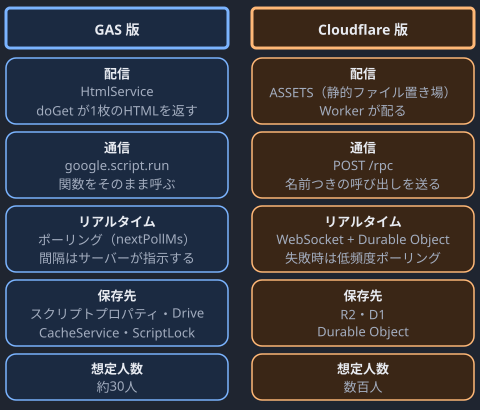
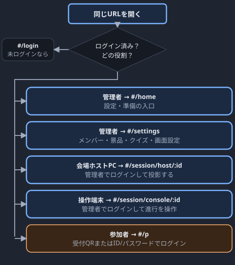
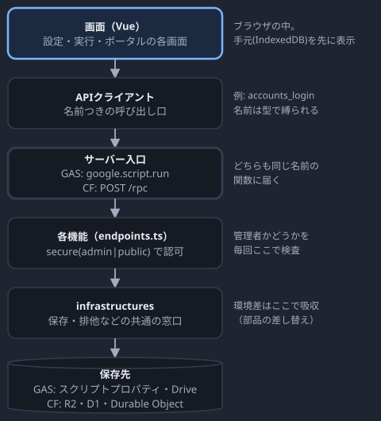
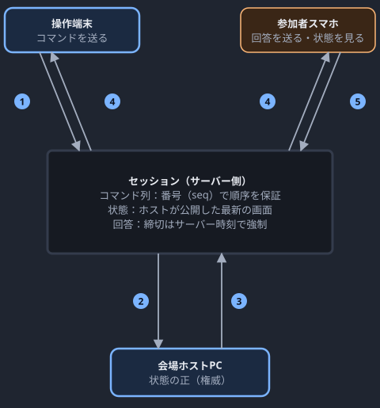
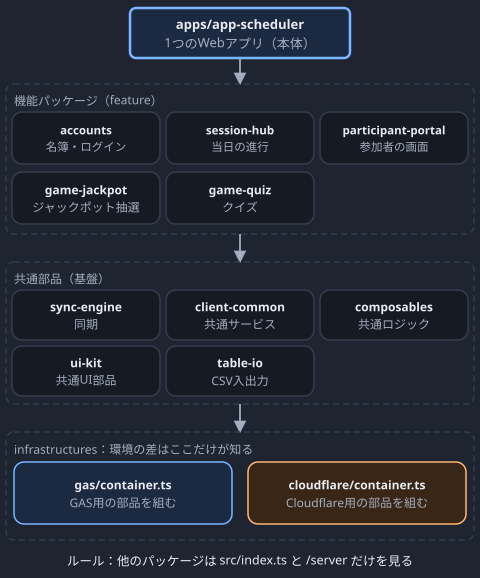

# OctopusScheduler のしくみ(図解) {#architecture}

アプリの構成と、管理者・参加者・サーバーがどうつながるかを、視点別の図で説明します。これから保守する人や、全体を知りたい人向けです。専門用語は最後の用語集にまとめています。

## 1. ひと目でわかる全体像 {#a1}

要点
<ul>
<li>人が触るのは、管理者・会場ホストPC・操作端末・参加者スマホの4種類。どれも<b>同じURLの1つのWebアプリ</b>を開く</li>
<li>アプリの裏側(サーバー)は <b>GAS</b> か <b>Cloudflare</b> のどちらか一方で動く。画面は同じ</li>
<li>データは、サーバー側の保存先に置かれる。保存先の種類は動かし方で違う</li>
</ul>

OctopusScheduler は、忘年会などでクイズ大会と抽選会を行うWebアプリです。インストールは不要で、ブラウザだけで動きます。下の図は、人・アプリ・サーバー・保存先が上から下につながる全体像です。

 → 保存先。サーバーは二重線の枠、保存先は円筒で表しています。")

図の見方:角丸の枠=人・画面、太い枠=Webアプリ、二重線の枠=サーバー、円筒=保存先、青系=GAS・管理側、橙系=Cloudflare・参加者側(色が違っても枠の形と文字で区別できます)。

| 登場するもの | 意味 |
| --- | --- |
| **会場ホストPC** | プロジェクターにつないだPC。管理者でログインして、演出画面を映す |
| **操作端末** | 司会者の手元のスマホやPC。ボタンで進行を指示する |
| **サーバー** | データを預かり、画面からの依頼を処理する場所(GAS または Cloudflare) |
| **保存先** | 名簿・画像・設定などを実際にしまう場所 |

## 2. 2つの動かし方:GASとCloudflare {#a2}

要点
<ul>
<li>同じアプリを、<b>GAS</b>(Googleの無料サーバー)でも<b>Cloudflare</b>(クラウド基盤)でも動かせる</li>
<li>違うのは、配信・通信・リアルタイムの方法・保存先・想定人数</li>
<li>参加者が約30人までなら GAS、数百人なら Cloudflare が目安</li>
<li>画面とゲームの中身は共通。差は <code>infrastructures</code> だけに閉じている</li>
</ul>

| 項目 | GAS | Cloudflare |
| --- | --- | --- |
| **配信(画面を届ける)** | HtmlService。`doGet` が1枚のHTMLを返す | Worker が `ASSETS`(静的ファイル置き場)から配る |
| **通信** | `google.script.run` | `POST /rpc` |
| **リアルタイム(更新の受け取り)** | ポーリング(定期的に聞きに行く)。間隔はサーバーが `nextPollMs` で指示 | WebSocket(つなぎっぱなし)+Durable Object。失敗すると低頻度のポーリングに自動で切り替え |
| **排他(同時書き込みの調整)** | ScriptLock | D1 の `locks` と、Durable Object の直列実行 |
| **保存先** | スクリプトプロパティ・Drive・CacheService | R2・D1・Durable Object |
| **想定人数** | 約30人 | 数百人 |

<b>ポイント</b>どちらで動いているかは、アプリを使う人は気にしなくて構いません。デプロイの手順は <a href="../dev/deploy-gas.md">deploy-gas.md</a> と <a href="../dev/deploy-cloudflare.md">deploy-cloudflare.md</a> にあります。

## 3. 役割と画面 {#a3}

要点
<ul>
<li>URLは1つ。<b>ログインしたアカウントの役割</b>(管理者か参加者)で、行き先の画面が決まる</li>
<li>管理者は <code>#/home</code>、参加者は <code>#/p</code> に着地する</li>
<li>会場ホストPCと操作端末は、どちらも管理者でログインして、セッションごとの画面を開く</li>
<li>参加者が管理画面のURLを直接開いても、<code>#/p</code> に戻される</li>
</ul>

| ルート(URLの # 以降) | 誰が使うか | 何をする画面か |
| --- | --- | --- |
| **`#/login`** | 全員 | ログイン(受付QRもここに着地して自動でログイン) |
| **`#/home`** | 管理者 | 設定・準備の入口 |
| **`#/settings`** | 管理者 | メンバー・景品・クイズ・画面設定 |
| **`#/session/host/:id`** | 会場ホストPC(管理者) | セッションの演出画面。状態の正を持つ |
| **`#/session/console/:id`** | 操作端末(管理者) | 「次へ」などの指示を送る |
| **`#/p`** | 参加者 | エントリー・回答・結果の確認 |

<code>:id</code> はセッションごとに変わる番号です。入口のUXはブラウザ側の案内で、本当の防御はサーバー側の認可です(第5章)。

## 4. 通信のしくみ {#a4}

要点
<ul>
<li>画面とサーバーの会話は、<b>型付きの呼び出し</b>(RPC)で行う。名前は <code>&lt;prefix&gt;_&lt;name&gt;</code></li>
<li>GAS と Cloudflare で入口は違うが、同じ名前の関数に届く</li>
<li>各機能は <code>secure("admin"|"public")</code> で、誰が呼べるかを宣言する</li>
<li><code>npm run verify</code> が、画面側の呼び出し名とサーバー側の関数が合っているかを突き合わせる</li>
</ul>

RPC は「遠くにある関数を、名前を指定して呼ぶ」しくみです。名前の前半(prefix)が機能の持ち主を表します。

| グループ | 持ち主 | 代表的な操作 |
| --- | --- | --- |
| **`accounts_*`** | accounts | `login`・`loginWithKey`・`listMembers`・`applyRoster`・`getSession` |
| **`sessionHub_*`** | session-hub | `createSession`・`joinOperator`・`poll`・`issueCommand`・`submitAnswer` |
| **`quizGame_*`** | game-quiz | `getRecord`・`saveRecord`・`putBlob`・`getBlob` |
| **`jackpotGame_*`** | game-jackpot | `getRecord`・`saveRecord`・`addJson`・`getJson` |
| **`octopusScheduler_*`** | app-scheduler | `doGet`(画面配信)・`getAssetBlob`・`saveAssetRecord` |

## 5. ログインと認証 {#a5}

要点
<ul>
<li>ログインは <b>ID+パスワード</b>、または受付の<b>QR鍵</b>。成功するとセッショントークン(有効7日)を受け取る</li>
<li>以降の呼び出しは、サーバーが<b>毎回</b>トークンを検証する</li>
<li>同じIDで5回連続失敗すると15分ロック。Cloudflareは、さらにIP単位のレート制限を持つ</li>
<li>最初の管理者は、ブートストラップ用のシークレットで作る</li>
</ul>

と、ログイン後の毎回の検証(下半分)。点線の矢印は返事です。")

1. ブラウザが、ID+パスワードまたはQR鍵を送る。
2. 入口が accounts 機能に認証を頼む。
3. 失敗回数を保存先で確認する(5回連続の失敗で15分ロック。成功で戻る)。
4. 合格なら、セッションを保存先に記録する(有効7日。1人10セッションまで。超えると古い順に失効)。
5. accounts がトークンを入口へ渡す。
6. 入口がトークンをブラウザに返す。ブラウザはそれを保存する(localStorage)。
7. 以降は、トークンつきで呼ぶ。
8. 入口が accounts にトークンの検証を頼む。
9. accounts が保存先のセッションと照合する。
10. OKなら処理を実行し、NGなら拒否して返す。

| 項目 | 内容 |
| --- | --- |
| **エンドポイントの区分** | すべて `secure("admin")`(管理者のみ)か `secure("public")`(ログイン済みの誰でも。参加者向け)のどちらかを宣言する |
| **セッションの期限** | 7日。1人あたり最大10セッション |
| **総当たり対策** | 同じIDで5回連続失敗すると15分ロック。成功でリセット |
| **Cloudflareの追加対策** | IP単位のレート制限(ログイン用60回/分、公開エンドポイント用1200回/分)。会場の共有IPでも弾かれない広さにしてある |
| **初回管理者** | ブートストラップ用パスワード(シークレット)を登録し、ID `admin` でログインすると作られる。管理者が1人でもログインできれば無効になる |

詳しくは <a href="../dev/authentication.md">authentication.md</a> を参照してください。

## 6. 当日の進行(セッションハブ) {#a6}

要点
<ul>
<li><b>ホスト</b>(会場PC)が状態の正。<b>操作端末</b>はコマンドを送り、<b>参加者</b>は回答を送る</li>
<li>3者は<b>セッション</b>(サーバー側のルーム)を介してつながり、直接は話さない</li>
<li>Cloudflareは WebSocket で即時に届け、GAS は定期的に聞きに行く(ポーリング)</li>
<li>締切はサーバー時刻で決まるので、ホストのタブが落ちても自動で終わる</li>
</ul>

1. 操作端末がコマンド(画面を進める等)を送る。番号(seq)で順序を保証し、再送は重複を捨てる。
2. ホストがコマンドを順に1回ずつ適用する(リロード後も二重に適用しない)。
3. ホストが、いまの状態を公開する。
4. セッションが、状態・在席・回答数を操作端末と参加者へ配る(参加者には運営向けの情報を渡さない)。
5. 参加者が、ホストが許可した回答だけを送る。

|  | GAS | Cloudflare |
| --- | --- | --- |
| **更新の受け取り** | ポーリング(サーバーが `nextPollMs` で間隔を指示) | WebSocket(Durable Object が押し出す)。失敗時は低頻度ポーリング |
| **排他** | ScriptLock | Durable Object の直列実行(ロック不要) |
| **回答の保存** | 値を25件ずつに分けて保存(100件まで) | メモリに溜め、約2秒後にまとめて保存(alarm) |
| **想定人数** | 約30人 | 数百人 |

設計の詳細と運用は <a href="../dev/session-hub.md">session-hub.md</a> にあります。

## 7. データの保存先マップ {#a7}

要点
<ul>
<li>保存するものを4種類(単純な値・ファイルとJSON・キャッシュと排他・セッションルーム)に分け、GASとCloudflareで置き場所を変える</li>
<li>端末(ブラウザ)の <code>IndexedDB</code> がまず画面を出し、背景で<b>sync-engine</b>がサーバーと揃える</li>
<li>同期は「新しい書き込みが勝つ」。通信待ちを画面に出さない</li>
</ul>

| 種類 | GAS | Cloudflare |
| --- | --- | --- |
| **単純な値(名簿・設定)** | スクリプト プロパティ | R2(`__scalars__/` の下) |
| **ファイル・JSON(画像・音声・一覧)** | Drive(ルートフォルダ配下) | R2 |
| **キャッシュ・排他** | CacheService・ScriptLock | D1(`cache_entries`・`locks`) |
| **セッションルーム** | スクリプト プロパティ(KV) | Durable Object(`SESSION_ROOM`) |

ファイルと JSON は、環境を問わず `<module>/<kind>/<name>` のパスで指し、パスの組み立ては `storage-paths.ts` に集めてあります。一覧は種類ごとに `{ data, updatedAt }` を1件持ち、更新日時の新しいほうが勝ちます。

<b>注意</b>2台でほぼ同時に別の項目を編集すると、あとから保存した一覧が残ります(一覧全体を1つの単位として同期するため)。

## 8. コードの構成(パッケージ地図) {#a8}

要点
<ul>
<li>monorepo(1つのリポジトリに複数パッケージ)。本体は <code>apps/app-scheduler</code> の1つだけ</li>
<li>機能(accounts・session-hub・participant-portal・game-jackpot・game-quiz)と、基盤(infrastructures ほか)に分ける</li>
<li>他のパッケージの <code>src/index.ts</code> と <code>/server</code> だけを使う。内部パスには触れない</li>
<li>GAS/Cloudflareの違いは <code>infrastructures</code> の <code>gas/container.ts</code> と <code>cloudflare/container.ts</code> だけが知る</li>
</ul>

| パッケージ | 役目 |
| --- | --- |
| **apps/app-scheduler** | 画面の組み立てと、ルート・ログイン案内(本体) |
| **accounts** | メンバー名簿・ログイン・セッション・認可 |
| **session-hub** | ホスト/操作/参加者を結ぶセッション基盤 |
| **participant-portal** | ログイン済み参加者向けのスマホ画面 |
| **game-jackpot / game-quiz** | ジャックポット抽選 / クイズ |
| **infrastructures** | GAS/Cloudflareの実装を差し替える層 |
| **sync-engine** | 端末とサーバーの同期 |
| **client-common / composables / ui-kit** | 共通サービス / 共通ロジック / 共通UI部品 |
| **table-io** | CSV の読み書き |

詳しくは <a href="../dev/architecture.md">architecture.md</a> を参照してください。

## 9. ビルド・デプロイ・CIの流れ {#a9}

要点
<ul>
<li><code>npm run build</code> が各パッケージをビルドし、<code>scripts/prepare-dist.js</code> が <code>dist/gas</code> と <code>dist/cloudflare</code> にまとめる</li>
<li><code>npm run verify</code> が、サーバー関数の契約と成果物を検査する</li>
<li>GAS は <code>deploy:gas</code>(clasp)、Cloudflare は <code>prod:up</code>(wrangler)</li>
<li>GitHub Actions では、lint・unit・typecheck・build を並列に走らせ、最後に verify で集約する</li>
</ul>

のジョブ構成。build の成果物を、check-dist と e2e が使います。")

| コマンド | やること |
| --- | --- |
| **`npm run build`** | 全パッケージをビルドして dist を作る |
| **`npm run verify`** | `verify:gas`(契約)+`verify:dist`(成果物) |
| **`npm run deploy:gas`** | build して `clasp push` |
| **`npm run prod:up`** | `scripts/cf-env.js prod up`: D1/R2 の作成(無ければ) → D1 のマイグレーション → `wrangler deploy`(要 `npm run build`) |
| **`npm run dev:stack`** | ローカルで丸ごと起動して確認する |
| **`npm run dev:up` / `staging:up`(と `:down`)** | Cloudflareの開発環境・検証環境を作る / 片付ける(本番とは別のWorker・D1・R2) |

手順は <a href="../dev/deploy-gas.md">deploy-gas.md</a>・<a href="../dev/deploy-cloudflare.md">deploy-cloudflare.md</a>・<a href="../dev/development.md">development.md</a> を参照してください。

## 10. 用語集と関連ドキュメント {#a10}

要点知らない言葉に出会ったらここへ。詳しい説明は下の関連ドキュメントへ進んでください。

<dl class="qa">
<dt>GAS(Google Apps Script)</dt><dd>Googleのアカウントで動かせる無料のサーバー環境。</dd>
<dt>Cloudflare Workers</dt><dd>Cloudflareが提供する、小さなプログラムを動かす基盤。このアプリでは <code>/rpc</code> と <code>/ws/&lt;sessionId&gt;</code> を受け持つ。</dd>
<dt>R2 / D1 / Durable Object</dt><dd>Cloudflareの保存先。R2=ファイル置き場、D1=小さなデータベース、Durable Object=セッションごとに1つ持つ「部屋」(状態を覚えて、WebSocketを受ける)。</dd>
<dt>RPC</dt><dd>遠くの関数を名前で呼ぶしくみ。このアプリでは <code>&lt;prefix&gt;_&lt;name&gt;</code> の形。</dd>
<dt>ポーリング / WebSocket</dt><dd>ポーリング=一定間隔で聞きに行く。WebSocket=つなぎっぱなしで、変化があったらすぐ届く。</dd>
<dt>セッション</dt><dd>2つの意味がある。ログインの有効期間(トークン)と、当日の進行の「部屋」(セッションハブ)。</dd>
<dt>ホスト / 操作端末</dt><dd>ホスト=会場の投影PC(状態の正)。操作端末=司会の手元(コマンドを送る)。</dd>
<dt>IndexedDB</dt><dd>ブラウザの中にある保存場所。まず手元から表示し、背景でサーバーと揃える。</dd>
<dt>sync-engine</dt><dd>端末とサーバーを「新しい書き込みが勝つ」で揃える部品。</dd>
<dt>ブートストラップ</dt><dd>最初の管理者を作るための、一時的なシークレット(パスワード)。</dd>
<dt>monorepo / turbo</dt><dd>複数パッケージを1つのリポジトリで管理する形 / そのビルドを効率よく回す道具。</dd>
<dt>clasp / wrangler</dt><dd>GAS / Cloudflare にデプロイするコマンドラインの道具。</dd>
<dt>e2e</dt><dd>実際の画面を自動で操作して、通しで動くか確かめるテスト。</dd>
</dl>

### 関連ドキュメント {#related}

<a href="../dev/architecture.md"><b>architecture.md</b>パッケージ構成、依存ルール、保存パス、同期</a>
<a href="../dev/session-hub.md"><b>session-hub.md</b>セッション基盤の設計と運用</a>
<a href="../dev/authentication.md"><b>authentication.md</b>ログイン、初回管理者、復旧</a>
<a href="../dev/deploy-gas.md"><b>deploy-gas.md</b>GASへのデプロイ</a>
<a href="../dev/deploy-cloudflare.md"><b>deploy-cloudflare.md</b>Cloudflareへのデプロイ、無料枠</a>
<a href="../dev/development.md"><b>development.md</b>セットアップ、コマンド、テスト、CI</a>
<a href="../dev/design-decisions.md"><b>design-decisions.md</b>主な意思決定と学び</a>

